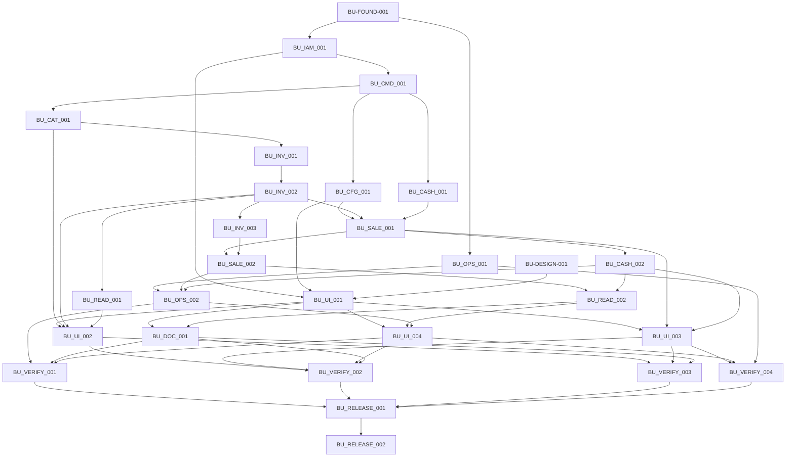

# 11 — Build Units, DAG, estimasi dan tracker

Baseline P0–P11 — **28 BU baru, 0/28 COMPLETE, semua NOT STARTED**. [P11](planning/P11-BUILD-UNITS.md) mencatat specification serta review/freeze P0–P10; [CORE-MAP](requirements/CORE-MAP.md) memuat 73 requirement dan [08](08-TESTING-ACCEPTANCE.md) memuat 39 suite/0 FINAL PASS. Plan 2.0/T01–T40 menjadi [input historis](archive/plan2/README.md), bukan instruksi task pertama yang aktif.

## Eksekusi dan hold

Baca AGENTS → 00 → dokumen ini/kartu → 01/02/10 → READ specification; [CLAUDE](../CLAUDE.md) menyediakan handoff portable. Satu primary executor menjalankan satu **Execute BU-...** yang diotorisasi eksplisit; independent review boleh paralel, tanpa otomatis melanjutkan next. Otorisasi rebaseline saat ini hanya planning dan satu commit dokumentasi lokal, tanpa implementasi aplikasi.

Artifact provider harus mempunyai scope/evidence PASS pada revision kompatibel. Backend COMPLETE berarti evidence backend bounded, bukan workflow client/produk FINAL; hold bisnis aktual tidak memblokir engineering terisolasi yang independen. UI produksi memerlukan **BU-DESIGN-001 COMPLETE** dengan approval exact revision owner dan rights; context teramati atau blueprint freeze saja tidak mencukupi.

Hold final/evidence test mengikuti [GAPS](planning/GAPS-CHANGES.md)/[08](08-TESTING-ACCEPTANCE.md). Label model owner: Claude Opus 5.5/xhigh; Fable 5.1/xhigh hanya untuk eskalasi bounded berisiko tinggi. Availability diverifikasi sebelum eksekusi; jangan mengklaim telah digunakan. RELEASE untuk exact target/revision/operation dan approval destruktif tetap terpisah.

## Estimasi dari nol

I = implementasi, V = verifikasi terarah wajib, E = evidence/docs (jam fokus). Boundary dan angka dirancang ulang berdasarkan scope aktual, integrasi Laravel, decimal presisi/race PostgreSQL/privasi/UI nyata/recovery/perangkat; bukan scaling 236h lama atau throughput token AI. Seluruh jam merupakan penilaian engineering, bukan benchmark/perjanjian. Pembelajaran framework/model, host aktual atau perubahan policy dapat menambah kerja; reestimasi sesudah evidence.

| BU | Hasil | Dependency artifact | I | V | E | Total | Status |
| --- | --- | --- | ---: | ---: | ---: | ---: | --- |
| [BU-FOUND-001](build-units/BU-FOUND-001.md) | Fondasi Laravel, React dan harness PostgreSQL terisolasi | — | 4 | 3 | 1 | 8 | NOT STARTED |
| [BU-IAM-001](build-units/BU-IAM-001.md) | Autentikasi, lifecycle akun dan otorisasi tiga role | BU-FOUND-001 | 5 | 4 | 1 | 10 | NOT STARTED |
| [BU-CMD-001](build-units/BU-CMD-001.md) | Command identity, audit atomik dan original-result recovery | BU-IAM-001 | 5 | 4 | 1 | 10 | NOT STARTED |
| [BU-CFG-001](build-units/BU-CFG-001.md) | BusinessProfile, config guards dan logo revision privat | BU-CMD-001 | 4 | 3 | 1 | 8 | NOT STARTED |
| [BU-CAT-001](build-units/BU-CAT-001.md) | Master barang, harga, Product Search dan registry barcode | BU-CMD-001 | 5 | 4 | 1 | 10 | NOT STARTED |
| [BU-INV-001](build-units/BU-INV-001.md) | Immutable ledger, balance sinkron dan MWA UNKNOWN | BU-CAT-001 | 6 | 5 | 1 | 12 | NOT STARTED |
| [BU-INV-002](build-units/BU-INV-002.md) | Receiving, manual issue dan opening owner-only | BU-INV-001 | 5 | 4 | 1 | 10 | NOT STARTED |
| [BU-INV-003](build-units/BU-INV-003.md) | Owner adjustment, evidence revision dan reversal/replay berbatas | BU-INV-002 | 7 | 5 | 1 | 13 | NOT STARTED |
| [BU-CASH-001](build-units/BU-CASH-001.md) | Logical register dan pembukaan sesi kas sendiri | BU-CMD-001 | 3 | 3 | 1 | 7 | NOT STARTED |
| [BU-SALE-001](build-units/BU-SALE-001.md) | Sale full-payment atomik dan receipt snapshot | BU-CFG-001, BU-INV-002, BU-CASH-001 | 7 | 5 | 1 | 13 | NOT STARTED |
| [BU-CASH-002](build-units/BU-CASH-002.md) | Race-safe close dan immutable session report | BU-SALE-001 | 4 | 4 | 1 | 9 | NOT STARTED |
| [BU-SALE-002](build-units/BU-SALE-002.md) | Bounded owner refund dan verified physical return | BU-SALE-001, BU-INV-003 | 5 | 4 | 1 | 10 | NOT STARTED |
| [BU-READ-001](build-units/BU-READ-001.md) | Current stock, LOW/OUT dan safe operational history | BU-INV-002 | 3 | 3 | 1 | 7 | NOT STARTED |
| [BU-READ-002](build-units/BU-READ-002.md) | Owner finance, sesi dan audit reads dengan scope ketat | BU-SALE-002, BU-CASH-002 | 5 | 4 | 1 | 10 | NOT STARTED |
| [BU-OPS-001](build-units/BU-OPS-001.md) | Packaging self-host, Nginx TLS dan SQL privilege protection | BU-FOUND-001 | 4 | 3 | 1 | 8 | NOT STARTED |
| [BU-OPS-002](build-units/BU-OPS-002.md) | Reconciliation, independent backup dan restore tooling | BU-OPS-001, BU-SALE-002, BU-CASH-002 | 5 | 4 | 1 | 10 | NOT STARTED |
| [BU-DESIGN-001](build-units/BU-DESIGN-001.md) | Approved DesainPakeAI revision dan repository visual contract | — | 3 | 2 | 1 | 6 | NOT STARTED |
| [BU-UI-001](build-units/BU-UI-001.md) | Native shared shell, autentikasi dan account/config UI | BU-IAM-001, BU-CFG-001, BU-DESIGN-001 | 4 | 3 | 1 | 8 | NOT STARTED |
| [BU-UI-002](build-units/BU-UI-002.md) | Product Operations lengkap: katalog, receipt, opening dan current stock | BU-UI-001, BU-CAT-001, BU-INV-002, BU-READ-001 | 7 | 5 | 1 | 13 | NOT STARTED |
| [BU-UI-003](build-units/BU-UI-003.md) | POS draft/scanner, full payment, open/close dan own-history UI | BU-UI-001, BU-SALE-001, BU-CASH-002 | 7 | 5 | 1 | 13 | NOT STARTED |
| [BU-UI-004](build-units/BU-UI-004.md) | Owner corrections, finance/session/audit dan system UI | BU-UI-001, BU-READ-002, BU-OPS-002 | 7 | 5 | 1 | 13 | NOT STARTED |
| [BU-DOC-001](build-units/BU-DOC-001.md) | Code128 label, thermal/A4 nota dan immutable session exports | BU-UI-001, BU-READ-002 | 4 | 4 | 1 | 9 | NOT STARTED |
| [BU-VERIFY-001](build-units/BU-VERIFY-001.md) | Final populated migration dan independent restore/recovery acceptance | BU-OPS-002, BU-DOC-001, BU-UI-004 | 0 | 7 | 1 | 8 | NOT STARTED |
| [BU-VERIFY-002](build-units/BU-VERIFY-002.md) | Final integrated business, RBAC/privacy, security dan UX acceptance | BU-UI-002, BU-UI-003, BU-UI-004, BU-DOC-001 | 0 | 8 | 1 | 9 | NOT STARTED |
| [BU-VERIFY-003](build-units/BU-VERIFY-003.md) | Final scanner dan label/receipt printer nyata | BU-UI-002, BU-UI-003, BU-DOC-001 | 0 | 5 | 1 | 6 | NOT STARTED |
| [BU-VERIFY-004](build-units/BU-VERIFY-004.md) | Final representative VPS performance dan bounded replay capacity | BU-UI-003, BU-UI-004, BU-OPS-001 | 0 | 5 | 1 | 6 | NOT STARTED |
| [BU-RELEASE-001](build-units/BU-RELEASE-001.md) | Readiness, cutover/UAT package dan owner gates | BU-VERIFY-001, BU-VERIFY-002, BU-VERIFY-003, BU-VERIFY-004 | 1 | 3 | 1 | 5 | NOT STARTED |
| [BU-RELEASE-002](build-units/BU-RELEASE-002.md) | Authorized production cutover, owner pilot dan handoff | BU-RELEASE-001 | 3 | 4 | 1 | 8 | NOT STARTED |

JSON [registry](build-units/registry.json) menyimpan jam/dependency/status/commands/data/action/risiko exact. Kartu mempunyai READ/requirement/acceptance/tables/actions/UI/permission/races/VERIFY/STOP/UPDATE/COMMIT/NEXT; klausul canonical tetap berlaku.

## Dependency DAG

Graf/tabel/register berasal dari data yang sama: 28 ID unik, seluruh dependency tersedia, tanpa cycle. Topological order yang valid:
`BU-FOUND-001 → BU-IAM-001 → BU-CMD-001 → BU-CFG-001 → BU-CAT-001 → BU-INV-001 → BU-INV-002 → BU-INV-003 → BU-CASH-001 → BU-SALE-001 → BU-CASH-002 → BU-SALE-002 → BU-READ-001 → BU-READ-002 → BU-OPS-001 → BU-OPS-002 → BU-DESIGN-001 → BU-UI-001 → BU-UI-002 → BU-UI-003 → BU-UI-004 → BU-DOC-001 → BU-VERIFY-001 → BU-VERIFY-002 → BU-VERIFY-003 → BU-VERIFY-004 → BU-RELEASE-001 → BU-RELEASE-002`.
BU-DESIGN-001 tidak bergantung secara teknis pada foundation; pekerjaan visual owner dapat berjalan saat backend dikerjakan. Eksekusi pertama tetap BU-FOUND-001 setelah instruksi owner; jangan memilih next otomatis.

## Engineering, critical path dan kalender

| Komponen | Jam |
| --- | ---: |
| Implementasi | 113 |
| Verifikasi | 118 |
| Evidence/docs | 28 |
| **Engineering total** | **259** |
| Risk reserve terpisah | 56 |
| Total jika seluruh reserve terpakai | 315 |

Critical dependency path berbobot I + V + E dengan resource independen, tanpa waiting owner/eksternal: **128h**:
`BU-FOUND-001 → BU-IAM-001 → BU-CMD-001 → BU-CAT-001 → BU-INV-001 → BU-INV-002 → BU-SALE-001 → BU-SALE-002 → BU-READ-002 → BU-UI-004 → BU-VERIFY-002 → BU-RELEASE-001 → BU-RELEASE-002`.
Ada path dengan durasi sama pada branch Sale/correction; validator menentukan satu longest path valid. Ini dependency lower bound, **bukan durasi kalender dengan satu coding executor**.

Satu executor minimum 259h = 32,375 hari × 8h = 6,475 minggu × 40h (~6,5 minggu). Dengan reserve: 315h = 39,375 hari/~7,9 minggu. Pada 6h fokus/hari: 43,17 hari tanpa reserve. Waiting owner/perangkat/access/visual/policy/key/deploy aktual menambah elapsed time dan tidak dihitung sebagai kerja engineering. Tidak ada janji produksi dalam satu bulan.

Reserve 56h: framework/auth/DTO types/advisory 8; stock/money/concurrency/replay 18; visual native/mobile 12; hardware 6; migration/restore/TLS/performance 12. Reserve adalah allowance risiko, bukan credit implementasi atau entitlement scope. Perbaikan defect signifikan pada verifikasi final tidak dianggap gratis.

## Waiting eksternal terpisah

DESIGN untuk approval exact revision/rights; G1 tax/buyer; G2 unit/catalog/opening/evidence biaya; G3 drawer/funding; G4 independent backup/access/measured RPO/RTO; DEVICES; TARGET terotorisasi/availability EXECUTOR; serta RELEASE. Tidak ada estimasi waiting tanpa fakta Pemilik/provider. Backend/database/tests/ops non-production independen boleh berjalan setelah BU diotorisasi eksplisit; acceptance client/produksi nyata berhenti sesuai gate terdampak.

## Status, evidence dan closeout

NOT STARTED, IN PROGRESS, WAITING TECHNICAL CHECK, WAITING OWNER REVIEW, WAITING EXTERNAL, BLOCKED, COMPLETE. Catat delivery bounded + commands/target/dataset/revision/results + review/fix + applicable holds. COMPLETE BU tidak otomatis produk FINAL; final point suite pada 08: 33 terintegrasi di BU-VERIFY-002, tiga database/recovery di BU-VERIFY-001, hardware di BU-VERIFY-003, performance di BU-VERIFY-004 dan release aktual di BU-RELEASE-002.

Self-review + independent/adversarial review diperlukan sesuai area; review kedua untuk risiko tinggi bila temuan/risiko membenarkannya. Race/rollback/constraints/permission PostgreSQL aktual, checks PHP/TypeScript/browser lima viewport + zoom 200%, perangkat fisik/restore/benchmark mengikuti risiko. Checks belum dijalankan tetap PENDING, bukan PASS.

Update BU/11/evidence, keputusan nyata pada 10, lalu 00 LAST. Stage path exact/review index/hash yang dilindungi; commit lokal task hanya bila terotorisasi, koheren dan checks PASS. Tidak ada izin tersirat push/merge/deploy/publish/pembelian/reset destruktif. STOP setelah BU aktif; sesi rebaseline STOP setelah satu commit docs-only.

## Preservasi dan scope perubahan planning

Intake awal: branch plan/bantukasir-pos-v1/HEAD c4a145d, 0 staged/0 unstaged/0 untracked. Leftovers BK03 yang disebut dokumen sebelumnya tidak ada pada intake ini; tidak menebak actor/proses dan tidak merekonstruksinya. Hash 85 file source/aset/evidence yang dilindungi tercatat pada snapshot ignored .local/rebaseline-p0-p11/before; binary/source prototype/aset tidak diubah. README register historis diperbarui untuk fakta aktual dan pipeline terkini.

40 kartu lama dipindahkan ke archive/plan2/tasks dengan banner historis/adaptasi link relatif; canonical sebelum rebaseline tersedia pada Git c4a145d. Requirement valid diserap, tanpa implementasi kode aplikasi/database/file runtime. [Validation/review](evidence/rebaseline-p0-p11/REVIEW.md) mencatat command/temuan aktual/preservasi. 00 ditulis LAST setelah seluruh specification/review/validation, lalu checks staging dan satu commit planning.