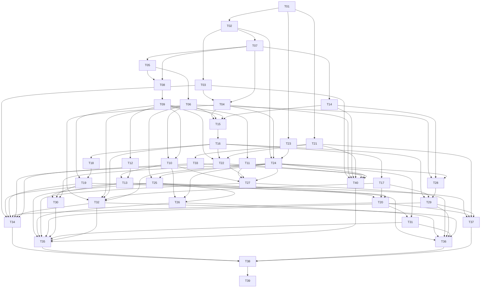

# 11 — Build plan dan task graph

**Plan 2.0 — 1–2 Oktober 2026.** Rebaseline dari kebutuhan dan risiko aktual. **40 task Core, 0/40 COMPLETE, semua NOT STARTED; tidak ada executor coding aktif.** Task pertama [T01](tasks/T01.md) belum diotorisasi untuk dijalankan oleh sesi rebaseline. Tidak ada kredit aplikasi produksi dari prototype historis.

## Cara menjalankan

Sesi baru menerima “Execute Txx”, membaca [AGENTS](../AGENTS.md) → [00](00-CURRENT-STATE.md) → dokumen ini/kartu → PRD/arsitektur/keputusan dan READ spesifik. Satu executor aktif; task berhenti sesudah closeout. Kartu berisi scope, tindakan, checks, acceptance, holds, commit dan NEXT ALLOWED yang tidak mengotorisasi task berikut.

Dependency di tabel adalah **artifact teknis**. Sebelum consumer dijalankan, pastikan provider mempunyai bukti yang tercatat pada revision yang kompatibel untuk scope itu. Jika provider WAITING OWNER REVIEW/EXTERNAL, consumer independen hanya boleh memakai artifact teknis yang sudah lulus dan dibekukan; ini tidak mengubah provider menjadi COMPLETE. Pengecualian tegas: **T23 harus COMPLETE dengan owner-approved visual contract sebelum T24/UI produksi**. RELEASE tetap memerlukan semua acceptance/gates terkait selesai.

Visual yang menunggu owner tidak menahan T01–T22 dan backup/recovery backend yang independen. T23 dapat dikerjakan awal sesudah T01; owner dapat menyiapkan desain bersamaan dengan engineering. Status waiting tidak memakai slot executor. Scope actual client, G2 counts, actual devices, G4 destination dan production deployment tidak boleh dilaksanakan hanya karena kode teknis tersedia.

## Estimasi per task

I = implementasi; V = verifikasi; E = evidence/docs; semua dalam jam fokus. Estimasi mencakup targeted checks dan dokumentasi tiap task, belum elapsed waiting/rework. T35–T37 mempunyai implementasi 0 karena tugasnya verifikasi final; perbaikan baru yang signifikan memakai risk reserve atau reestimasi yang tercatat, bukan dianggap gratis.

| TASK | Hasil | Dependency teknis | I | V | E | Total | Status |
| --- | --- | --- | ---: | ---: | ---: | ---: | --- |
| [T01](tasks/T01.md) | Fondasi aplikasi dan PostgreSQL terisolasi | — | 4 | 2 | 1 | 7 | NOT STARTED |
| [T02](tasks/T02.md) | Sesi autentikasi dan role server | T01 | 3.5 | 2 | 0.5 | 6 | NOT STARTED |
| [T03](tasks/T03.md) | Bootstrap, undangan, reset dan pencabutan akses | T02 | 2.5 | 2 | 0.5 | 5 | NOT STARTED |
| [T04](tasks/T04.md) | Identitas bisnis runtime dan aset privat | T03, T07 | 3.5 | 2 | 0.5 | 6 | NOT STARTED |
| [T05](tasks/T05.md) | Master produk dan harga terotorisasi | T07 | 3.5 | 2 | 0.5 | 6 | NOT STARTED |
| [T06](tasks/T06.md) | Product Search dan registry barcode | T05 | 2 | 1.5 | 0.5 | 4 | NOT STARTED |
| [T07](tasks/T07.md) | Command, audit dan protokol hasil asli | T02 | 4 | 2.5 | 0.5 | 7 | NOT STARTED |
| [T08](tasks/T08.md) | Ledger stok dan proyeksi sinkron | T05, T07 | 3.5 | 2 | 0.5 | 6 | NOT STARTED |
| [T09](tasks/T09.md) | MWA dan posting biaya UNKNOWN | T08 | 4 | 3 | 1 | 8 | NOT STARTED |
| [T10](tasks/T10.md) | Backend barang masuk dan manual issue | T06, T09 | 3.5 | 2 | 0.5 | 6 | NOT STARTED |
| [T11](tasks/T11.md) | Opening manual dan pembekuan onboarding | T09 | 2 | 1.5 | 0.5 | 4 | NOT STARTED |
| [T12](tasks/T12.md) | Replay biaya deterministik berbatas | T09 | 4 | 2.5 | 0.5 | 7 | NOT STARTED |
| [T13](tasks/T13.md) | Revisi biaya, adjustment dan reversal Pemilik | T10, T12 | 3 | 2.5 | 0.5 | 6 | NOT STARTED |
| [T14](tasks/T14.md) | Logical register dan pembukaan sesi | T07 | 2.5 | 2 | 0.5 | 5 | NOT STARTED |
| [T15](tasks/T15.md) | Validasi Sale server dan kontrak snapshot | T04, T06, T09, T14 | 4 | 2.5 | 0.5 | 7 | NOT STARTED |
| [T16](tasks/T16.md) | Commit Sale atomik dan pemulihan tahan lama | T15 | 3 | 2.5 | 0.5 | 6 | NOT STARTED |
| [T17](tasks/T17.md) | Penutupan tahan balapan dan snapshot sesi immutable | T16 | 3.5 | 3 | 0.5 | 7 | NOT STARTED |
| [T18](tasks/T18.md) | Refund uang berbatas oleh Pemilik | T16 | 2 | 1.5 | 0.5 | 4 | NOT STARTED |
| [T19](tasks/T19.md) | Pengembalian fisik dan biaya historis | T09, T18 | 2.5 | 2 | 0.5 | 5 | NOT STARTED |
| [T20](tasks/T20.md) | Backend query keuangan, sesi dan audit | T13, T17, T19 | 4.5 | 3 | 0.5 | 8 | NOT STARTED |
| [T21](tasks/T21.md) | Packaging dan privilege SQL terlindungi | T01 | 3 | 1.5 | 0.5 | 5 | NOT STARTED |
| [T22](tasks/T22.md) | Rekonsiliasi dan guard posting terdampak | T09, T16, T21 | 2 | 1.5 | 0.5 | 4 | NOT STARTED |
| [T23](tasks/T23.md) | Kontrak visual dari sumber DesainPakeAI | T01 | 2.5 | 1.5 | 1 | 5 | NOT STARTED |
| [T24](tasks/T24.md) | Shell shadcn dan akun bersama | T02, T04, T23 | 4.5 | 2 | 0.5 | 7 | NOT STARTED |
| [T25](tasks/T25.md) | Katalog, review duplikasi dan UI barcode | T06, T24 | 3.5 | 2 | 0.5 | 6 | NOT STARTED |
| [T26](tasks/T26.md) | UI barang masuk dan manual issue | T10, T24, T25 | 3.5 | 2 | 0.5 | 6 | NOT STARTED |
| [T27](tasks/T27.md) | UI opening, stok, restock dan history | T10, T11, T22, T24 | 2 | 1.5 | 0.5 | 4 | NOT STARTED |
| [T28](tasks/T28.md) | Draft POS, HID dan keranjang | T06, T14, T24 | 3.5 | 2 | 0.5 | 6 | NOT STARTED |
| [T29](tasks/T29.md) | Checkout, penutupan sesi dan pemulihan hasil tidak pasti | T16, T17, T28 | 2.5 | 2 | 0.5 | 5 | NOT STARTED |
| [T30](tasks/T30.md) | UI koreksi, refund dan return Pemilik | T13, T19, T24 | 2.5 | 2 | 0.5 | 5 | NOT STARTED |
| [T31](tasks/T31.md) | UI laporan, history sesi dan audit | T20, T24 | 4 | 2.5 | 0.5 | 7 | NOT STARTED |
| [T32](tasks/T32.md) | Label dan renderer dokumen immutable | T04, T06, T16, T17, T24 | 4.5 | 3 | 0.5 | 8 | NOT STARTED |
| [T33](tasks/T33.md) | Fondasi backup terenkripsi independen | T21 | 4 | 2.5 | 0.5 | 7 | NOT STARTED |
| [T34](tasks/T34.md) | Migrasi berisi data, restore dan recovery epoch | T03, T13, T19, T20, T22, T32, T33 | 3.5 | 4 | 0.5 | 8 | NOT STARTED |
| [T35](tasks/T35.md) | Penerimaan akhir privasi dan aksesibilitas lintas permukaan | T25, T26, T27, T29, T30, T31, T32, T40 | 0 | 5 | 1 | 6 | NOT STARTED |
| [T36](tasks/T36.md) | Scanner, label dan printer struk nyata | T25, T26, T27, T29, T31, T32 | 0 | 5 | 1 | 6 | NOT STARTED |
| [T37](tasks/T37.md) | Performance akhir dan kapasitas replay | T13, T20, T21, T29 | 0 | 4.5 | 0.5 | 5 | NOT STARTED |
| [T38](tasks/T38.md) | Kebijakan, cutover dan kesiapan pilot | T34, T35, T36, T37 | 1 | 2 | 1 | 4 | NOT STARTED |
| [T39](tasks/T39.md) | Cutover terotorisasi dan pilot Pemilik | T38 | 3 | 2 | 1 | 6 | NOT STARTED |
| [T40](tasks/T40.md) | UI administrasi Pemilik dan sistem | T03, T04, T14, T21, T22, T24, T33 | 3.5 | 2 | 0.5 | 6 | NOT STARTED |

## Graf dependency

Graf exact berikut dan tabel mempunyai source yang sama; 40 ID unik, semua dependency tersedia, DAG tanpa cycle. T40 sengaja di luar urutan angka karena system UI memakai backup status; **nomor bukan urutan eksekusi**.

Satu topological order yang valid:
`T01 → T02 → T03 → T07 → T04 → T05 → T06 → T08 → T09 → T10 → T11 → T12 → T13 → T14 → T15 → T16 → T17 → T18 → T19 → T20 → T21 → T22 → T23 → T24 → T25 → T26 → T27 → T28 → T29 → T30 → T31 → T32 → T33 → T34 → T40 → T35 → T36 → T37 → T38 → T39`.
Urutan ini bukan jadwal wajib. Setelah T01, T21/T23 dapat dimajukan bila target/approval tersedia; backend T02 berjalan saat visual menunggu.

## Jam engineering, critical path dan kalender

| Komponen | Jam |
| --- | ---: |
| Implementasi | 118 |
| Verifikasi | 94.5 |
| Evidence/docs | 23.5 |
| **Engineering total** | **236** |
| Risk reserve terpisah | **48** |
| Total bila seluruh reserve dipakai | **284** |

Critical path berbobot I+V+E pada graf dengan resource independen adalah **93h**:
`T01 → T02 → T07 → T05 → T08 → T09 → T15 → T16 → T18 → T19 → T20 → T31 → T35 → T38 → T39`.
Angka 93h adalah dependency lower bound tanpa waiting dan tanpa kendala satu executor; **bukan** durasi kalender proyek dengan satu executor.

Satu executor membutuhkan **236h = 29,5 hari × 8h = 5,9 minggu × 40h**. Bila seluruh reserve dipakai: **284h = 35,5 hari = 7,1 minggu**. Fokus nyata 6h/hari memperpanjang floor menjadi sekitar 39,3 hari engineering; owner waiting, devices, policy, credential, design approval dan release authorization menambah elapsed time. Tidak ada janji selesai satu bulan.

Reserve 48h: auth/version/adapter 6h; domain/concurrency/replay 16h; visual translation/mobile 10h; perangkat 6h; migration/recovery/target performance 10h. Ini allowance perencanaan, bukan scope baru atau hasil risiko yang sudah terjadi.

## Penghematan yang dapat dipertanggungjawabkan

- Satu Next.js native UI dari sumber DesainPakeAI approved menghilangkan pipeline membangun empat prototype lalu rebuild. Belum mengklaim nominal jam penghematan tanpa measurement.
- Search/DTO, command/audit/source-intent/locks dan dokumen berbagi primitive hanya karena mempunyai beberapa consumer nyata. Tugas feature menambah consumer/tes, tidak membuat framework generik.
- Auth/domain/backend serta packaging/backup mulai tanpa menunggu visual. Ini mengurangi waktu menganggur kalender, tidak mengurangi total kerja teknis.
- Acceptance dimulai dekat implementasi; final fan-in menggunakan suite nyata yang sama pada seluruh surface. Tidak membuat suite kedua yang meniru implementasi atau mengulang hardware pada setiap feature.
- Dokumen domain yang tumpang tindih digabung; cards menyimpan scope eksekusi dan mereferensikan spec, tidak menyalin ulang seluruh invariant.
- Replay sinkron bounded, SQL search, browser print, self-hosted auth dan satu DB menghindari worker/search/payment service yang tidak dibutuhkan. Batas capacity/UNKNOWN/performance tetap dibuktikan.

154h dan 172h lama bukan target atau constraint. Angka 236h adalah estimasi engineering minimum kredibel untuk scope berikut bukti auth lifecycle, biaya/history, race sesi, perangkat, restore dan mobile. Reestimasi sesudah evidence nyata bila asumsi versi, kapasitas atau client berubah.

## Ownership acceptance dan gates

[08](08-TESTING-ACCEPTANCE.md) mempunyai **37 suite** dan surface matrix. Setiap kebutuhan Core mempunyai implementation owner, targeted verification owner, final acceptance point. Unit/fixture/schema-only/early DB pass tidak boleh diberi FINAL PASS sebelum seluruh consumer/read/export/recovery surface ada.

- T35: final cross-surface correctness/RBAC/privacy/a11y pada candidate lengkap.
- T34: final populated migration/backup/restore/recovery epoch.
- T36: final actual scanner/label/receipt evidence.
- T37: final target performance dan replay capacity.
- T38: kesiapan owner/gates/cutover; belum deployment.
- T39: deployment hanya setelah approval exact target/revision, lalu owner pilot RELEASE01.

[10](10-DECISIONS.md) menyimpan DESIGN, G1, G2, G3, G4, DEVICES dan RELEASE; semuanya belum ditutup. RPO6h/RTO4h proposal, bukan SLA accepted. Template desain tidak mengaktifkan leads/target/tim. Produk baru tidak menciptakan stock. No stock/financial/privacy invariant boleh dikurangi demi tanggal.

## Definition of done dan status

Status: NOT STARTED, IN PROGRESS, WAITING TECHNICAL CHECK, WAITING OWNER REVIEW, WAITING EXTERNAL, BLOCKED, COMPLETE. Catat evidence teknis dan hold terpisah. COMPLETE task memerlukan VERIFY/ACCEPTANCE task beserta hold yang menentukan acceptance-nya; FINAL PASS suite memerlukan titik final dan semua consumer yang dipetakan. Snapshot atau report executor saja bukan pass.

Lakukan lint/typecheck/build dan tests yang relevan. Transaksi/constraints/rollback/races memakai PostgreSQL nyata. Browser/role/keyboard/touch/200%zoom pada 375/440/768/1024/1440; actual-device dan performance sesuai task. Catat revision, command, target/dataset non-secret, hasil/latensi, screenshot atau physical witness yang benar-benar ada; yang tidak dijalankan tetap PENDING.

Closeout: stage exact intended paths; periksa seluruh index agar unrelated BK03 tidak ikut. Commit lokal terisolasi hanya bila task terotorisasi dan koheren; no push/merge/deploy/purchase implied. Update11,10 hanya keputusan nyata, **00 LAST**. Jangan otomatis execute NEXT.

## Konsolidasi dokumen dan preservasi

| File obsolete yang diperiksa | Isi aktif dipindahkan ke | Alasan |
| --- | --- | --- |
| docs/03-DOMAIN-MODEL.md | [02](02-ARCHITECTURE.md) | Entities, constraints, precision dan concurrency satu otoritas |
| docs/05-DESIGN-SYSTEM.md | [DESIGN](../DESIGN.md) | Workflow source-to-production baru; no old tool gate |
| docs/07-BUSINESS-FLOWS.md | [01](01-PRD.md), [06](06-INVENTORY-SPEC.md), [15](15-FINANCE-PROFITABILITY.md), [17](17-POS-SALES.md), [09](09-DEPLOYMENT-OPS.md) | Flows mengikuti spec domain/recovery |
| docs/13-NOTIFICATIONS.md | [06](06-INVENTORY-SPEC.md) | Current LOW/OUT, refresh/error dan Later delivery boundary |
| docs/14-BULK-IMPORT.md | [06](06-INVENTORY-SPEC.md), [01](01-PRD.md) | Manual opening Core; safe import boundary hanya Later |
| docs/16-EXECUTOR-HANDOFF.md | [AGENTS](../AGENTS.md), [00](00-CURRENT-STATE.md), kartu tasks | Handoff/task recovery satu jalur Codex |
| PRODUCT.md | [01](01-PRD.md), [DESIGN](../DESIGN.md) | Ringkasan tanpa unique active requirement |
| .impeccable/design.json + 2 surfaces metadata | [DESIGN](../DESIGN.md), [08](08-TESTING-ACCEPTANCE.md) | Semantic/accessibility quality constraints dipertahankan; token/source/tool metadata lama superseded |

Prototype/source/aset/license/evidence lama tetap disimpan sebagai referensi state dan provenance, termasuk staged serta unstaged BK03 dan209 untracked. Registry [prototype](../prototypes/README.md) menandai seluruhnya historis. Tidak ada source aplikasi, fixture owner, binary atau database dihapus.

Sebelum rebaseline edit dibuat snapshot ignored `.local/rebaseline-snapshot/20261001-plan2/`: HEAD/index/worktree/status, binary git patches serta SHA-256 protected/untracked. docs00/11 yang tumpang tindih dengan pekerjaan sebelumnya sudah disimpan; canonical sekarang menggantikannya sesuai otorisasi rebaseline. Commit dokumentasi memakai allowlist exact, mempertahankan enam staged object BK03 dan tiga source unstaged.
