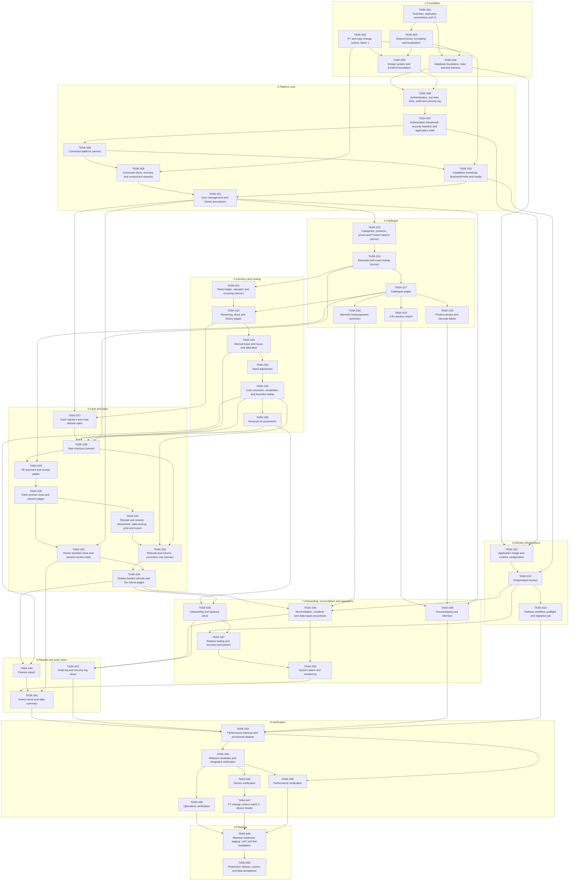

# Dependency graph

| | |
| --- | --- |
| Status | CURRENT — written in RF-7 under D-090, 18 October 2026 (Asia/Jakarta); corrected under D-091 and D-092 the same day; approved by D-092; generated from [TASK_PLAN](TASK_PLAN.md) section 4, which prevails |
| Phase | P11 |
| Related | [TASK_PLAN](TASK_PLAN.md), [EXECUTION_CONTEXT](EXECUTION_CONTEXT.md), [TRACEABILITY](TRACEABILITY.md) |

How the Tasks depend on each other, which can run at the same time, and which chain decides the earliest end. A dependency means that the later Task needs what the earlier one delivers merged into `develop` and `DONE`.

## 1. How to read

- An arrow `A --> B` means B depends on A. Only direct dependencies are drawn; what a Task needs transitively follows from them.
- A **wave** is the earliest step in which a Task's dependencies allow it, counting Tasks without dependencies as wave 1. Gates are not counted.
- Gates are in TASK_PLAN section 3; they can hold a Task after its dependencies are done.

## 2. Graph

## 3. Dependencies per Task

| Task | Depends on | Depended on by | Wave | Lane |
| --- | --- | --- | --- | --- |
| [TASK-001](tasks/TASK-001-toolchain-ci.md) | — | [TASK-003](tasks/TASK-003-kernel-localization.md), [TASK-004](tasks/TASK-004-database-foundation.md) | 1 | P |
| [TASK-002](tasks/TASK-002-p7-change-control-1.md) | — | [TASK-005](tasks/TASK-005-design-system.md), [TASK-009](tasks/TASK-009-command-client.md), [TASK-010](tasks/TASK-010-bootstrap-profile-media.md) | 1 | D |
| [TASK-003](tasks/TASK-003-kernel-localization.md) | [TASK-001](tasks/TASK-001-toolchain-ci.md) | [TASK-004](tasks/TASK-004-database-foundation.md), [TASK-005](tasks/TASK-005-design-system.md) | 2 | P |
| [TASK-004](tasks/TASK-004-database-foundation.md) | [TASK-001](tasks/TASK-001-toolchain-ci.md), [TASK-003](tasks/TASK-003-kernel-localization.md) | [TASK-006](tasks/TASK-006-authentication.md), [TASK-012](tasks/TASK-012-application-image.md) | 3 | P |
| [TASK-005](tasks/TASK-005-design-system.md) | [TASK-002](tasks/TASK-002-p7-change-control-1.md), [TASK-003](tasks/TASK-003-kernel-localization.md) | [TASK-006](tasks/TASK-006-authentication.md) | 3 | P |
| [TASK-006](tasks/TASK-006-authentication.md) | [TASK-004](tasks/TASK-004-database-foundation.md), [TASK-005](tasks/TASK-005-design-system.md) | [TASK-007](tasks/TASK-007-authorization-shell.md) | 4 | P |
| [TASK-007](tasks/TASK-007-authorization-shell.md) | [TASK-006](tasks/TASK-006-authentication.md) | [TASK-008](tasks/TASK-008-command-platform.md), [TASK-012](tasks/TASK-012-application-image.md) | 5 | P |
| [TASK-008](tasks/TASK-008-command-platform.md) | [TASK-007](tasks/TASK-007-authorization-shell.md) | [TASK-009](tasks/TASK-009-command-client.md), [TASK-010](tasks/TASK-010-bootstrap-profile-media.md) | 6 | P |
| [TASK-009](tasks/TASK-009-command-client.md) | [TASK-002](tasks/TASK-002-p7-change-control-1.md), [TASK-008](tasks/TASK-008-command-platform.md) | [TASK-011](tasks/TASK-011-user-management.md) | 7 | P |
| [TASK-010](tasks/TASK-010-bootstrap-profile-media.md) | [TASK-002](tasks/TASK-002-p7-change-control-1.md), [TASK-008](tasks/TASK-008-command-platform.md) | [TASK-011](tasks/TASK-011-user-management.md), [TASK-013](tasks/TASK-013-independent-backup.md) | 7 | P |
| [TASK-011](tasks/TASK-011-user-management.md) | [TASK-009](tasks/TASK-009-command-client.md), [TASK-010](tasks/TASK-010-bootstrap-profile-media.md) | [TASK-015](tasks/TASK-015-catalog-core.md), [TASK-027](tasks/TASK-027-registers-session-open.md), [TASK-032](tasks/TASK-032-assisted-close-notes.md), [TASK-038](tasks/TASK-038-housekeeping.md) | 8 | P |
| [TASK-012](tasks/TASK-012-application-image.md) | [TASK-004](tasks/TASK-004-database-foundation.md), [TASK-007](tasks/TASK-007-authorization-shell.md) | [TASK-013](tasks/TASK-013-independent-backup.md) | 6 | O |
| [TASK-013](tasks/TASK-013-independent-backup.md) | [TASK-010](tasks/TASK-010-bootstrap-profile-media.md), [TASK-012](tasks/TASK-012-application-image.md) | [TASK-014](tasks/TASK-014-release-pipeline.md), [TASK-036](tasks/TASK-036-reconciliation-repair.md), [TASK-037](tasks/TASK-037-restore-tooling.md) | 8 | O |
| [TASK-014](tasks/TASK-014-release-pipeline.md) | [TASK-013](tasks/TASK-013-independent-backup.md) | [TASK-043](tasks/TASK-043-performance-harness.md) | 9 | O |
| [TASK-015](tasks/TASK-015-catalog-core.md) | [TASK-011](tasks/TASK-011-user-management.md) | [TASK-016](tasks/TASK-016-barcodes.md) | 9 | C |
| [TASK-016](tasks/TASK-016-barcodes.md) | [TASK-015](tasks/TASK-015-catalog-core.md) | [TASK-017](tasks/TASK-017-catalog-pages.md), [TASK-021](tasks/TASK-021-ledger-receiving.md), [TASK-028](tasks/TASK-028-checkout.md) | 10 | C |
| [TASK-017](tasks/TASK-017-catalog-pages.md) | [TASK-016](tasks/TASK-016-barcodes.md) | [TASK-018](tasks/TASK-018-photos-labels.md), [TASK-019](tasks/TASK-019-csv-import.md), [TASK-020](tasks/TASK-020-barcode-correction.md), [TASK-022](tasks/TASK-022-receiving-stock-pages.md), [TASK-029](tasks/TASK-029-till-pages.md) | 11 | C |
| [TASK-018](tasks/TASK-018-photos-labels.md) | [TASK-017](tasks/TASK-017-catalog-pages.md) | [TASK-038](tasks/TASK-038-housekeeping.md) | 12 | C |
| [TASK-019](tasks/TASK-019-csv-import.md) | [TASK-017](tasks/TASK-017-catalog-pages.md) | [TASK-038](tasks/TASK-038-housekeeping.md) | 12 | C |
| [TASK-020](tasks/TASK-020-barcode-correction.md) | [TASK-017](tasks/TASK-017-catalog-pages.md) | [TASK-036](tasks/TASK-036-reconciliation-repair.md) | 12 | C |
| [TASK-021](tasks/TASK-021-ledger-receiving.md) | [TASK-016](tasks/TASK-016-barcodes.md) | [TASK-022](tasks/TASK-022-receiving-stock-pages.md) | 11 | I |
| [TASK-022](tasks/TASK-022-receiving-stock-pages.md) | [TASK-017](tasks/TASK-017-catalog-pages.md), [TASK-021](tasks/TASK-021-ledger-receiving.md) | [TASK-023](tasks/TASK-023-manual-issue.md), [TASK-027](tasks/TASK-027-registers-session-open.md) | 12 | I |
| [TASK-023](tasks/TASK-023-manual-issue.md) | [TASK-022](tasks/TASK-022-receiving-stock-pages.md) | [TASK-024](tasks/TASK-024-stock-adjustment.md), [TASK-028](tasks/TASK-028-checkout.md) | 13 | I |
| [TASK-024](tasks/TASK-024-stock-adjustment.md) | [TASK-023](tasks/TASK-023-manual-issue.md) | [TASK-025](tasks/TASK-025-cost-correction.md) | 14 | I |
| [TASK-025](tasks/TASK-025-cost-correction.md) | [TASK-024](tasks/TASK-024-stock-adjustment.md) | [TASK-026](tasks/TASK-026-reversal.md), [TASK-028](tasks/TASK-028-checkout.md), [TASK-033](tasks/TASK-033-refunds-core.md), [TASK-040](tasks/TASK-040-finance-report.md) | 15 | I |
| [TASK-026](tasks/TASK-026-reversal.md) | [TASK-025](tasks/TASK-025-cost-correction.md) | [TASK-028](tasks/TASK-028-checkout.md), [TASK-035](tasks/TASK-035-onboarding.md) | 16 | I |
| [TASK-027](tasks/TASK-027-registers-session-open.md) | [TASK-011](tasks/TASK-011-user-management.md), [TASK-022](tasks/TASK-022-receiving-stock-pages.md) | [TASK-028](tasks/TASK-028-checkout.md) | 13 | S |
| [TASK-028](tasks/TASK-028-checkout.md) | [TASK-016](tasks/TASK-016-barcodes.md), [TASK-023](tasks/TASK-023-manual-issue.md), [TASK-025](tasks/TASK-025-cost-correction.md), [TASK-026](tasks/TASK-026-reversal.md), [TASK-027](tasks/TASK-027-registers-session-open.md) | [TASK-029](tasks/TASK-029-till-pages.md), [TASK-033](tasks/TASK-033-refunds-core.md) | 17 | S |
| [TASK-029](tasks/TASK-029-till-pages.md) | [TASK-017](tasks/TASK-017-catalog-pages.md), [TASK-028](tasks/TASK-028-checkout.md) | [TASK-030](tasks/TASK-030-session-close.md) | 18 | S |
| [TASK-030](tasks/TASK-030-session-close.md) | [TASK-029](tasks/TASK-029-till-pages.md) | [TASK-031](tasks/TASK-031-documents-sales-lookup.md), [TASK-032](tasks/TASK-032-assisted-close-notes.md) | 19 | S |
| [TASK-031](tasks/TASK-031-documents-sales-lookup.md) | [TASK-030](tasks/TASK-030-session-close.md) | [TASK-033](tasks/TASK-033-refunds-core.md) | 20 | S |
| [TASK-032](tasks/TASK-032-assisted-close-notes.md) | [TASK-011](tasks/TASK-011-user-management.md), [TASK-030](tasks/TASK-030-session-close.md) | [TASK-034](tasks/TASK-034-drawer-refunds.md), [TASK-041](tasks/TASK-041-owner-home-daily.md) | 20 | S |
| [TASK-033](tasks/TASK-033-refunds-core.md) | [TASK-025](tasks/TASK-025-cost-correction.md), [TASK-028](tasks/TASK-028-checkout.md), [TASK-031](tasks/TASK-031-documents-sales-lookup.md) | [TASK-034](tasks/TASK-034-drawer-refunds.md) | 21 | S |
| [TASK-034](tasks/TASK-034-drawer-refunds.md) | [TASK-032](tasks/TASK-032-assisted-close-notes.md), [TASK-033](tasks/TASK-033-refunds-core.md) | [TASK-035](tasks/TASK-035-onboarding.md), [TASK-036](tasks/TASK-036-reconciliation-repair.md), [TASK-040](tasks/TASK-040-finance-report.md) | 22 | S |
| [TASK-035](tasks/TASK-035-onboarding.md) | [TASK-026](tasks/TASK-026-reversal.md), [TASK-034](tasks/TASK-034-drawer-refunds.md) | [TASK-037](tasks/TASK-037-restore-tooling.md), [TASK-042](tasks/TASK-042-audit-views.md) | 23 | I |
| [TASK-036](tasks/TASK-036-reconciliation-repair.md) | [TASK-013](tasks/TASK-013-independent-backup.md), [TASK-020](tasks/TASK-020-barcode-correction.md), [TASK-034](tasks/TASK-034-drawer-refunds.md) | [TASK-039](tasks/TASK-039-system-status.md), [TASK-042](tasks/TASK-042-audit-views.md) | 23 | O |
| [TASK-037](tasks/TASK-037-restore-tooling.md) | [TASK-013](tasks/TASK-013-independent-backup.md), [TASK-035](tasks/TASK-035-onboarding.md) | [TASK-039](tasks/TASK-039-system-status.md) | 24 | O |
| [TASK-038](tasks/TASK-038-housekeeping.md) | [TASK-011](tasks/TASK-011-user-management.md), [TASK-018](tasks/TASK-018-photos-labels.md), [TASK-019](tasks/TASK-019-csv-import.md) | [TASK-043](tasks/TASK-043-performance-harness.md) | 13 | O |
| [TASK-039](tasks/TASK-039-system-status.md) | [TASK-036](tasks/TASK-036-reconciliation-repair.md), [TASK-037](tasks/TASK-037-restore-tooling.md) | [TASK-041](tasks/TASK-041-owner-home-daily.md) | 25 | O |
| [TASK-040](tasks/TASK-040-finance-report.md) | [TASK-025](tasks/TASK-025-cost-correction.md), [TASK-034](tasks/TASK-034-drawer-refunds.md) | [TASK-041](tasks/TASK-041-owner-home-daily.md) | 23 | R |
| [TASK-041](tasks/TASK-041-owner-home-daily.md) | [TASK-032](tasks/TASK-032-assisted-close-notes.md), [TASK-039](tasks/TASK-039-system-status.md), [TASK-040](tasks/TASK-040-finance-report.md) | [TASK-043](tasks/TASK-043-performance-harness.md) | 26 | R |
| [TASK-042](tasks/TASK-042-audit-views.md) | [TASK-035](tasks/TASK-035-onboarding.md), [TASK-036](tasks/TASK-036-reconciliation-repair.md) | [TASK-043](tasks/TASK-043-performance-harness.md) | 24 | R |
| [TASK-043](tasks/TASK-043-performance-harness.md) | [TASK-014](tasks/TASK-014-release-pipeline.md), [TASK-038](tasks/TASK-038-housekeeping.md), [TASK-041](tasks/TASK-041-owner-home-daily.md), [TASK-042](tasks/TASK-042-audit-views.md) | [TASK-044](tasks/TASK-044-integrated-verification.md), [TASK-048](tasks/TASK-048-performance-verification.md) | 27 | V |
| [TASK-044](tasks/TASK-044-integrated-verification.md) | [TASK-043](tasks/TASK-043-performance-harness.md) | [TASK-045](tasks/TASK-045-operations-verification.md), [TASK-046](tasks/TASK-046-device-verification.md), [TASK-048](tasks/TASK-048-performance-verification.md) | 28 | V |
| [TASK-045](tasks/TASK-045-operations-verification.md) | [TASK-044](tasks/TASK-044-integrated-verification.md) | [TASK-049](tasks/TASK-049-release-readiness.md) | 29 | V |
| [TASK-046](tasks/TASK-046-device-verification.md) | [TASK-044](tasks/TASK-044-integrated-verification.md) | [TASK-047](tasks/TASK-047-p7-change-control-2.md) | 29 | V |
| [TASK-047](tasks/TASK-047-p7-change-control-2.md) | [TASK-046](tasks/TASK-046-device-verification.md) | [TASK-049](tasks/TASK-049-release-readiness.md) | 30 | D |
| [TASK-048](tasks/TASK-048-performance-verification.md) | [TASK-043](tasks/TASK-043-performance-harness.md), [TASK-044](tasks/TASK-044-integrated-verification.md) | [TASK-049](tasks/TASK-049-release-readiness.md) | 29 | V |
| [TASK-049](tasks/TASK-049-release-readiness.md) | [TASK-045](tasks/TASK-045-operations-verification.md), [TASK-047](tasks/TASK-047-p7-change-control-2.md), [TASK-048](tasks/TASK-048-performance-verification.md) | [TASK-050](tasks/TASK-050-production-pilot.md) | 31 | R |
| [TASK-050](tasks/TASK-050-production-pilot.md) | [TASK-049](tasks/TASK-049-release-readiness.md) | — | 32 | R |

## 4. Lanes and waves

| Lane | Tasks |
| --- | --- |
| P — Platform trunk | [TASK-001](tasks/TASK-001-toolchain-ci.md), [TASK-003](tasks/TASK-003-kernel-localization.md), [TASK-004](tasks/TASK-004-database-foundation.md), [TASK-005](tasks/TASK-005-design-system.md), [TASK-006](tasks/TASK-006-authentication.md), [TASK-007](tasks/TASK-007-authorization-shell.md), [TASK-008](tasks/TASK-008-command-platform.md), [TASK-009](tasks/TASK-009-command-client.md), [TASK-010](tasks/TASK-010-bootstrap-profile-media.md), [TASK-011](tasks/TASK-011-user-management.md) |
| D — Documents and change control | [TASK-002](tasks/TASK-002-p7-change-control-1.md), [TASK-047](tasks/TASK-047-p7-change-control-2.md) |
| O — Operations and delivery | [TASK-012](tasks/TASK-012-application-image.md), [TASK-013](tasks/TASK-013-independent-backup.md), [TASK-014](tasks/TASK-014-release-pipeline.md), [TASK-036](tasks/TASK-036-reconciliation-repair.md), [TASK-037](tasks/TASK-037-restore-tooling.md), [TASK-038](tasks/TASK-038-housekeeping.md), [TASK-039](tasks/TASK-039-system-status.md) |
| C — Catalogue | [TASK-015](tasks/TASK-015-catalog-core.md), [TASK-016](tasks/TASK-016-barcodes.md), [TASK-017](tasks/TASK-017-catalog-pages.md), [TASK-018](tasks/TASK-018-photos-labels.md), [TASK-019](tasks/TASK-019-csv-import.md), [TASK-020](tasks/TASK-020-barcode-correction.md) |
| I — Inventory and costing | [TASK-021](tasks/TASK-021-ledger-receiving.md), [TASK-022](tasks/TASK-022-receiving-stock-pages.md), [TASK-023](tasks/TASK-023-manual-issue.md), [TASK-024](tasks/TASK-024-stock-adjustment.md), [TASK-025](tasks/TASK-025-cost-correction.md), [TASK-026](tasks/TASK-026-reversal.md), [TASK-035](tasks/TASK-035-onboarding.md) |
| S — Cash and sales | [TASK-027](tasks/TASK-027-registers-session-open.md), [TASK-028](tasks/TASK-028-checkout.md), [TASK-029](tasks/TASK-029-till-pages.md), [TASK-030](tasks/TASK-030-session-close.md), [TASK-031](tasks/TASK-031-documents-sales-lookup.md), [TASK-032](tasks/TASK-032-assisted-close-notes.md), [TASK-033](tasks/TASK-033-refunds-core.md), [TASK-034](tasks/TASK-034-drawer-refunds.md) |
| R — Reports, audit views and release | [TASK-040](tasks/TASK-040-finance-report.md), [TASK-041](tasks/TASK-041-owner-home-daily.md), [TASK-042](tasks/TASK-042-audit-views.md), [TASK-049](tasks/TASK-049-release-readiness.md), [TASK-050](tasks/TASK-050-production-pilot.md) |
| V — Verification | [TASK-043](tasks/TASK-043-performance-harness.md), [TASK-044](tasks/TASK-044-integrated-verification.md), [TASK-045](tasks/TASK-045-operations-verification.md), [TASK-046](tasks/TASK-046-device-verification.md), [TASK-048](tasks/TASK-048-performance-verification.md) |

| Wave | Tasks whose dependencies allow them |
| --- | --- |
| 1 | [TASK-001](tasks/TASK-001-toolchain-ci.md), [TASK-002](tasks/TASK-002-p7-change-control-1.md) |
| 2 | [TASK-003](tasks/TASK-003-kernel-localization.md) |
| 3 | [TASK-004](tasks/TASK-004-database-foundation.md), [TASK-005](tasks/TASK-005-design-system.md) |
| 4 | [TASK-006](tasks/TASK-006-authentication.md) |
| 5 | [TASK-007](tasks/TASK-007-authorization-shell.md) |
| 6 | [TASK-008](tasks/TASK-008-command-platform.md), [TASK-012](tasks/TASK-012-application-image.md) |
| 7 | [TASK-009](tasks/TASK-009-command-client.md), [TASK-010](tasks/TASK-010-bootstrap-profile-media.md) |
| 8 | [TASK-011](tasks/TASK-011-user-management.md), [TASK-013](tasks/TASK-013-independent-backup.md) |
| 9 | [TASK-014](tasks/TASK-014-release-pipeline.md), [TASK-015](tasks/TASK-015-catalog-core.md) |
| 10 | [TASK-016](tasks/TASK-016-barcodes.md) |
| 11 | [TASK-017](tasks/TASK-017-catalog-pages.md), [TASK-021](tasks/TASK-021-ledger-receiving.md) |
| 12 | [TASK-018](tasks/TASK-018-photos-labels.md), [TASK-019](tasks/TASK-019-csv-import.md), [TASK-020](tasks/TASK-020-barcode-correction.md), [TASK-022](tasks/TASK-022-receiving-stock-pages.md) |
| 13 | [TASK-023](tasks/TASK-023-manual-issue.md), [TASK-027](tasks/TASK-027-registers-session-open.md), [TASK-038](tasks/TASK-038-housekeeping.md) |
| 14 | [TASK-024](tasks/TASK-024-stock-adjustment.md) |
| 15 | [TASK-025](tasks/TASK-025-cost-correction.md) |
| 16 | [TASK-026](tasks/TASK-026-reversal.md) |
| 17 | [TASK-028](tasks/TASK-028-checkout.md) |
| 18 | [TASK-029](tasks/TASK-029-till-pages.md) |
| 19 | [TASK-030](tasks/TASK-030-session-close.md) |
| 20 | [TASK-031](tasks/TASK-031-documents-sales-lookup.md), [TASK-032](tasks/TASK-032-assisted-close-notes.md) |
| 21 | [TASK-033](tasks/TASK-033-refunds-core.md) |
| 22 | [TASK-034](tasks/TASK-034-drawer-refunds.md) |
| 23 | [TASK-035](tasks/TASK-035-onboarding.md), [TASK-036](tasks/TASK-036-reconciliation-repair.md), [TASK-040](tasks/TASK-040-finance-report.md) |
| 24 | [TASK-037](tasks/TASK-037-restore-tooling.md), [TASK-042](tasks/TASK-042-audit-views.md) |
| 25 | [TASK-039](tasks/TASK-039-system-status.md) |
| 26 | [TASK-041](tasks/TASK-041-owner-home-daily.md) |
| 27 | [TASK-043](tasks/TASK-043-performance-harness.md) |
| 28 | [TASK-044](tasks/TASK-044-integrated-verification.md) |
| 29 | [TASK-045](tasks/TASK-045-operations-verification.md), [TASK-046](tasks/TASK-046-device-verification.md), [TASK-048](tasks/TASK-048-performance-verification.md) |
| 30 | [TASK-047](tasks/TASK-047-p7-change-control-2.md) |
| 31 | [TASK-049](tasks/TASK-049-release-readiness.md) |
| 32 | [TASK-050](tasks/TASK-050-production-pilot.md) |

A wave says when a Task may start. TASK-002 may start in wave 1, but it is merged into `develop` only after TASK-001 ([EXECUTION_CONTEXT](EXECUTION_CONTEXT.md) EXC-37), and TASK-001 is `DONE` only after gate GATE-PUBLISH.

## 5. Critical path

- **By number of Tasks** (32 Tasks): TASK-001 → TASK-003 → TASK-004 → TASK-006 → TASK-007 → TASK-008 → TASK-009 → TASK-011 → TASK-015 → TASK-016 → TASK-021 → TASK-022 → TASK-023 → TASK-024 → TASK-025 → TASK-026 → TASK-028 → TASK-029 → TASK-030 → TASK-031 → TASK-033 → TASK-034 → TASK-035 → TASK-037 → TASK-039 → TASK-041 → TASK-043 → TASK-044 → TASK-046 → TASK-047 → TASK-049 → TASK-050.
- **Weighted by size** (S 1, M 2, L 3, XL 4; total weight 92): TASK-001 → TASK-003 → TASK-004 → TASK-006 → TASK-007 → TASK-008 → TASK-010 → TASK-011 → TASK-015 → TASK-016 → TASK-021 → TASK-022 → TASK-023 → TASK-024 → TASK-025 → TASK-026 → TASK-028 → TASK-029 → TASK-030 → TASK-031 → TASK-033 → TASK-034 → TASK-035 → TASK-037 → TASK-039 → TASK-041 → TASK-043 → TASK-044 → TASK-045 → TASK-049 → TASK-050.
- **Gates on the way.** GATE-P11 before TASK-001 and TASK-002; GATE-BRANCH before TASK-001 and before the merge of TASK-002; GATE-PUBLISH before TASK-001 is `DONE` — its first push, pull request, CI and merge — and so before every later implementation Task; GATE-CC1 before TASK-005, TASK-009 and TASK-010; TARGET and the operator before TASK-044's staging part and before TASK-045, TASK-046 and TASK-048; G4's store before TASK-045; DEVICES before TASK-046; G1 to G4 before TASK-049; RELEASE and the acceptance of G4 before TASK-050.

## 6. Checks

| Check | Result |
| --- | --- |
| Tasks in the graph | 50 |
| Dependency edges | 84 |
| Every dependency names an existing Task with a smaller number | Yes |
| Cycles | 0 |
| Tasks without dependencies | TASK-001, TASK-002 |
| Tasks every other Task leads to | TASK-050 is a descendant of every Task: Yes |
| Waves | 32 |
